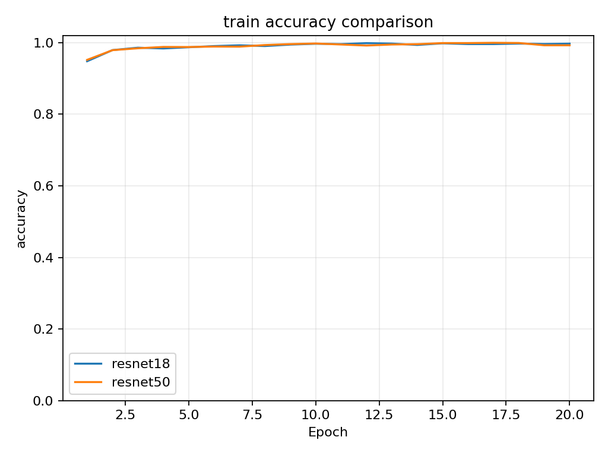
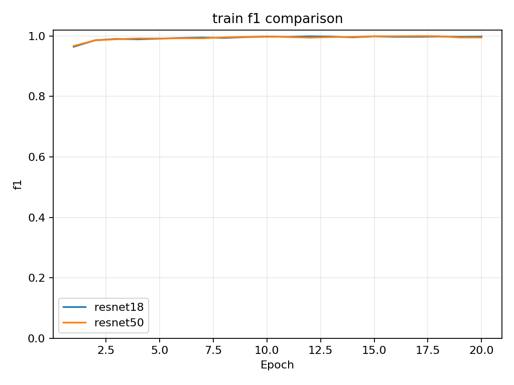
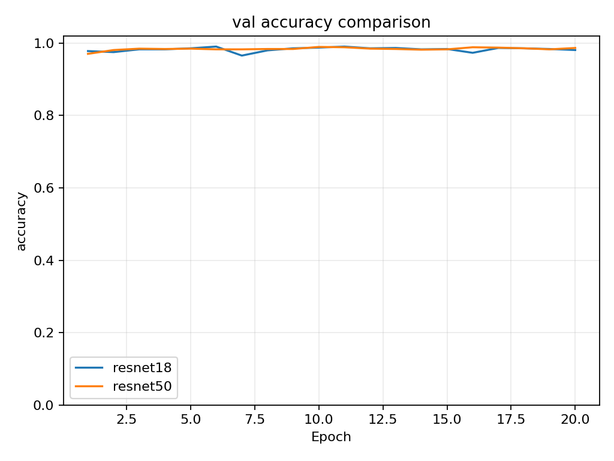
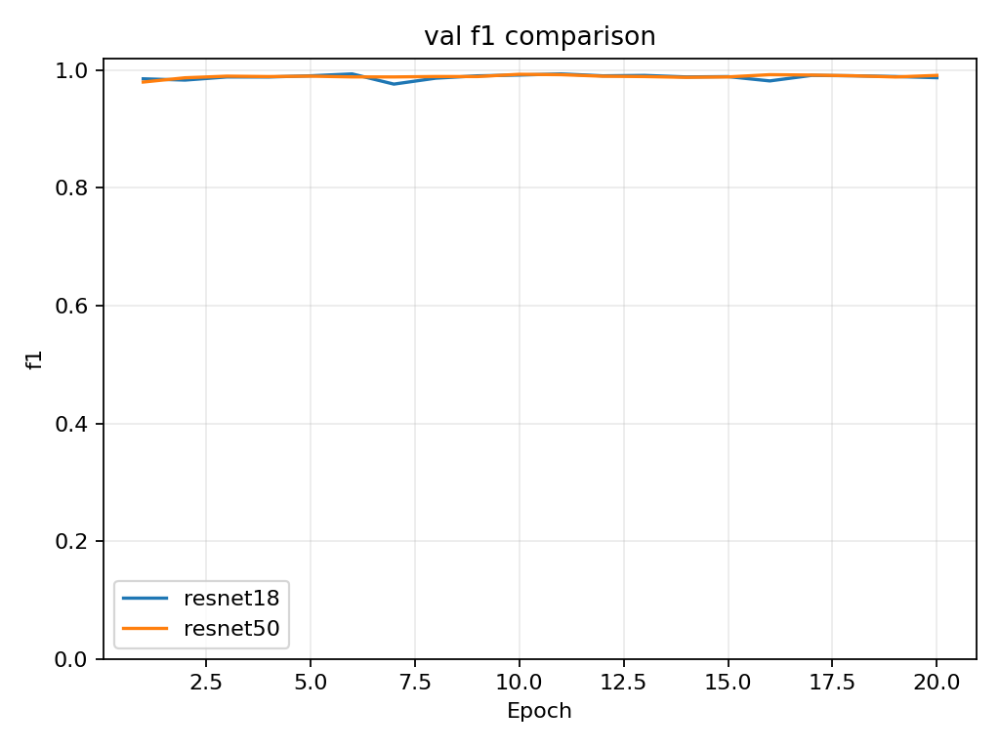
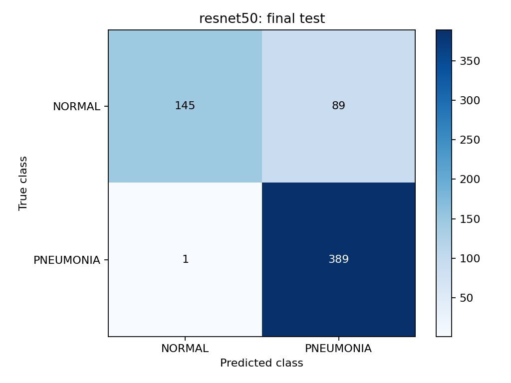

# Lab 1 — Pneumonia Classification

Binary classification of chest X-ray images using **ResNet18** and **ResNet50**, with a custom PyTorch dataset and data loaders. Both models were trained for 20 epochs with ImageNet pretrained weights and evaluated on the same held-out test set.

Repository: [Aurora-chang/Lab1](https://github.com/Aurora-chang/Lab1)

## Experimental results

Completed run: `20261014T062236237390Z`. The test set contains **624 images**: 234 NORMAL and 390 PNEUMONIA. Each model's checkpoint was selected by its highest **validation F1**, then evaluated on the test set after training.

| Model | Selected epoch | Test accuracy | Test F1 | Test precision | Test recall | Training time |
|---|---:|---:|---:|---:|---:|---:|
| ResNet18 | 6 | 81.73% | 0.8722 | 0.7749 | 0.9974 | 26.71 min |
| ResNet50 | 10 | **85.58%** | **0.8963** | **0.8138** | 0.9974 | 31.31 min |

Training time covers all 20 training/validation epochs and checkpoint saves, excluding the final test evaluation. Exact measurements are available in the [comparison summary](results/colab_20261014T062236237390Z/comparison/summary.csv), [ResNet18 test metrics](results/colab_20261014T062236237390Z/resnet18/test_metrics.json), and [ResNet50 test metrics](results/colab_20261014T062236237390Z/resnet50/test_metrics.json).

ResNet50 improved test accuracy by **3.85 percentage points**. It reduced normal images incorrectly predicted as pneumonia from 113 to 89; both models missed one pneumonia image. Validation accuracy at the selected checkpoints was 99.04% for ResNet18 and 98.95% for ResNet50, substantially higher than test accuracy. These measurements show a generalization gap; they do not establish its cause.

### Training and validation comparisons

| Training accuracy | Training F1 |
|---|---|
|  |  |

| Validation accuracy | Validation F1 |
|---|---|
|  |  |

### Final test confusion matrices

Rows represent true classes and columns predicted classes. Class order is **NORMAL, PNEUMONIA**; PNEUMONIA is the positive class. The matrix layout is `[[TN, FP], [FN, TP]]`.

| ResNet18 | ResNet50 |
|---|---|
|  |  |
| `[[121, 113], [1, 389]]` | `[[145, 89], [1, 389]]` |

Accuracy = `(TP + TN) / N`; precision = `TP / (TP + FP)`; recall = `TP / (TP + FN)`; F1 = `2TP / (2TP + FP + FN)`. Accuracy is displayed as a percentage above; the other metrics and CSV curves use a 0–1 scale. F1 is binary F1 for PNEUMONIA.

## Dataset and custom data loader

Dataset: [Chest X-Ray Images (Pneumonia), Kaggle](https://www.kaggle.com/datasets/paultimothymooney/chest-xray-pneumonia), handle `paultimothymooney/chest-xray-pneumonia`.

`ChestXrayDataset` in [dataset.py](dataset.py) discovers images, reads them with Pillow, converts them to RGB, applies transforms, and returns an image tensor with its label. Labels are **NORMAL=0** and **PNEUMONIA=1**. PyTorch DataLoader batches the samples, shuffles training images, and seeds workers.

Both models used the same seeded, stratified split of the supplied training images: approximately 80% for training and 20% for validation. The supplied `val` folder was unused; the supplied `test` split was held out.

| Split | NORMAL | PNEUMONIA | Total |
|---|---:|---:|---:|
| Training | 1,073 | 3,100 | 4,173 |
| Validation | 268 | 775 | 1,043 |
| Test | 234 | 390 | 624 |

The [saved split manifest](results/colab_20261014T062236237390Z/resnet18/split_manifest.json) lists every image path and label; it is identical for both models. The split is at image level and does not enforce patient grouping. The experiment uses one seed, so it does not measure variation across repeated runs. The original dataset version number was not captured in the exported metadata; match the saved filenames and split manifest when reproducing this run.

Training preprocessing: resize to 224×224, random rotation within ±10°, brightness/contrast jitter of 0.1, conversion to a tensor, and ImageNet normalization with mean `[0.485, 0.456, 0.406]` and standard deviation `[0.229, 0.224, 0.225]`. Validation and test use resizing and normalization without random augmentation.

## Models and training configuration

ResNet18 uses basic residual blocks; ResNet50 uses bottleneck residual blocks. Both use torchvision's `IMAGENET1K_V1` weights. The original classifier is replaced by a newly initialized two-output linear layer, and all parameters are fine-tuned.

| Setting | Value used for both models |
|---|---|
| Epochs | 20 |
| Batch size / image size | 32 / 224×224 |
| Optimizer | AdamW |
| Learning rate / weight decay | 0.0001 / 0.0001 |
| Loss | Class-weighted cross-entropy |
| Class weights | Training count / (2 × per-class training count) |
| Random seed / loader workers | 42 / 2 |
| Checkpoint selection | Highest validation F1; earliest epoch wins ties |
| Training device | CUDA GPU |
| PyTorch / torchvision | 2.11.0+cu130 / 0.26.0+cu130 |
| NumPy / Pillow / Matplotlib / tqdm | 2.1.3 / 11.3.0 / 3.10.0 / 4.67.3 |
| KaggleHub | 1.0.2 |

The GPU model and Python version were not recorded in the results archive. The full [training environment snapshot](results/colab_20261014T062236237390Z/environment.txt) and per-model configuration files preserve the available details. That snapshot includes unrelated Colab packages and is a record of the run, not a portable installation requirements file. `requirements-lock.txt` records the separate local software-test environment.

Training accuracy/F1 are accumulated during optimization on augmented images. Validation metrics are computed in evaluation mode after each epoch. Test data are not used for checkpoint selection.

## Run on Google Colab

1. Open [Google Colab](https://colab.research.google.com/) and upload [Lab1_Colab.ipynb](Lab1_Colab.ipynb) through **File → Upload notebook**.
2. Select **Runtime → Change runtime type → GPU**, then connect.
3. Run the cells in order. The first cell requests `Lab1_colab_code.zip`. To create it from a downloaded or cloned copy of this repository, run `python colab_bundle.py` locally.
4. Allow the notebook to mount Google Drive. It creates a unique result folder under `MyDrive/Lab1/runs/`.
5. The dataset cell downloads the data directly into Colab using KaggleHub and detects the correct split directory. If Kaggle requires authentication or consent, visit the dataset page and add `KAGGLE_API_TOKEN` to Colab Secrets with notebook access enabled; see [KaggleHub authentication](https://github.com/Kaggle/kagglehub#authenticate).
6. Train ResNet18 and ResNet50, display the comparisons, and download the results ZIP. Google Drive also retains the checkpoints, plots, metrics, and logs.

The notebook keeps Colab's preinstalled matching torch/torchvision packages, checks for a CUDA GPU, and records installed versions. An interrupted training job must be restarted in a fresh run folder; optimizer-state resume is not implemented. After editing local code, rebuild the upload ZIP before running another experiment.

## Run from the command line

Use Python 3.10 or later and install dependencies in a virtual environment:

```bash
python3 -m venv .venv
source .venv/bin/activate
python -m pip install -r requirements.txt
```

For a CUDA machine, install a matching torch/torchvision pair using the [official PyTorch installer](https://pytorch.org/get-started/locally/). Device selection defaults to CUDA, Apple MPS, or CPU according to availability. The first pretrained training run downloads ImageNet weights.

Download the dataset manually from Kaggle, or use:

```bash
python -m pip install kagglehub
python download_dataset.py
```

The helper prints the training-ready directory and records it in `data/dataset_location.json`. Set `DATASET` below to that directory, which must directly contain `train` and `test`:

```text
chest_xray/
  train/NORMAL/       train/PNEUMONIA/
  val/NORMAL/         val/PNEUMONIA/
  test/NORMAL/        test/PNEUMONIA/
```

To reproduce the recorded configuration in a new output folder:

```bash
DATASET="/path/to/chest_xray"
OUTPUT="results/reproduction"

python train.py --dataset "$DATASET" --model resnet18 --epochs 20 --batch-size 32 --lr 0.0001 --weight-decay 0.0001 --size 224 --seed 42 --workers 2 --val-fraction 0.2 --device cuda --output "$OUTPUT"
python train.py --dataset "$DATASET" --model resnet50 --epochs 20 --batch-size 32 --lr 0.0001 --weight-decay 0.0001 --size 224 --seed 42 --workers 2 --val-fraction 0.2 --device cuda --output "$OUTPUT"
python compare.py --runs "$OUTPUT/resnet18" "$OUTPUT/resnet50" --output "$OUTPUT/comparison"
python -m pip freeze > "$OUTPUT/environment.txt"
```

Run directories must be empty. Use a new `--output` directory for each experiment. Use `--device auto` for another supported device, `--batch-size 16` for lower memory use, or `--workers 0` if multiprocessing is unavailable; these change the recorded execution setup. `--official-val` uses the supplied validation folder and also changes the experiment. Identical seeds do not guarantee identical scores across hardware, libraries, or dataset versions.

## Inference and saved checkpoints

Each training run writes `best.pt`. The original completed run's checkpoints are saved locally and in its Google Drive result folder, and are excluded from Git. No public checkpoint download has been published. A fresh clone can generate checkpoints using the training commands above.

With the original results archive extracted into `results/colab_20261014T062236237390Z`, run:

```bash
CHECKPOINT="results/colab_20261014T062236237390Z/resnet50/best.pt"
python inference.py --checkpoint "$CHECKPOINT" --image /path/to/image.jpeg
python inference.py --checkpoint "$CHECKPOINT" --test-dir "$DATASET/test" --output evaluation/resnet50
```

Set `DATASET` to the downloaded dataset root before evaluating the full test set. For a newly trained model, use its corresponding `best.pt` path. Inference reconstructs the architecture and preprocessing from the checkpoint and returns the predicted class and softmax probabilities without downloading ImageNet weights.

## Project files and outputs

| File | Purpose |
|---|---|
| `dataset.py` | Custom dataset, preprocessing, split creation, and data loaders |
| `model.py` | ResNet construction and device selection |
| `train.py` | Training, validation-based checkpoint selection, and final test evaluation |
| `inference.py` | Single-image prediction or labeled test-set evaluation |
| `metrics.py`, `plots.py` | Binary metrics and figure generation |
| `compare.py` | Model comparison curves and summary CSV |
| `download_dataset.py` | Kaggle download and dataset-root detection |
| `Lab1_Colab.ipynb`, `colab_bundle.py` | Colab workflow and source ZIP builder |
| `test_pipeline.py` | Offline end-to-end software verification |
| `results/colab_20261014T062236237390Z/` | Completed experiment metrics, figures, logs, manifests, and environment |
| `report_template.md` | Structure for the separate written report |
| `sample.py` | Original incomplete course starter, retained for reference |

Each model directory contains `config.json`, `split_manifest.json`, `history.csv`, `test_metrics.json`, and accuracy/F1/loss/confusion-matrix PNGs. Local result directories also contain the ignored `best.pt` weights. The comparison directory contains four training/validation comparison figures and `summary.csv`.

Offline software checks use temporary synthetic images without downloaded pretrained weights:

```bash
OMP_NUM_THREADS=2 MKL_NUM_THREADS=2 python -m unittest test_pipeline -v
```

These checks cover both training pipelines, checkpoint reloads, test metric consistency, single-image inference, split separation, and comparison figures. Synthetic scores are not the experimental results reported above.

## Submission

Submit the separate report PDF to E3 as `LAB1_yourstudentID_name.pdf`, following the course specification. The report must include the introduction, model/data-loader setup, real results and screenshots, comparison curves, final test confusion matrices, discussion, and GitHub link. Validation comparison curves are available for the optional bonus.

Commit code, this README, and result figures/metrics to GitHub. Dataset folders, virtual environments, ZIP archives, and model checkpoints are excluded by `.gitignore`.

```bash
git add .
git commit -m "Complete Lab1 implementation and experiment results"
git push -u origin main
```
